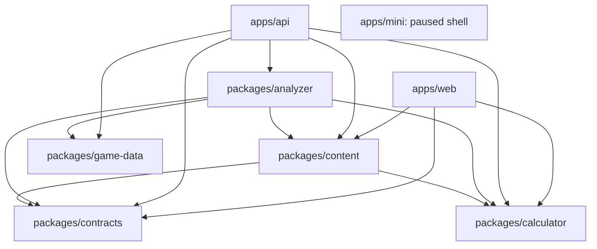
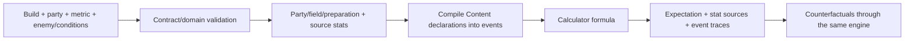

# GSCombat Current Architecture

[中文](architecture.md) · [Development guide](development.en.md) · [Architecture decisions](adr/README.md) ·
[Current issue ledger](plans/2026-10-08-architecture-review.md)

Updated 2026-10-19 against `main` at `496e16c` plus the uncommitted local ARCH-015/013/007 fixes, with game data 7.1.
This document describes implemented boundaries. Proposed improvements and verification limits belong in the issue ledger.

## 1. Product and system boundaries

GSCombat is a TypeScript modular monolith. The website and API deploy separately; domain packages share one repository.
Players configure a party of one to four characters, select a member and a core metric, and inspect its expected result,
resolved stats, formula trace, and counterfactual improvements. A damage metric may include multiple events from one action;
support metrics include healing, shields, and stat bonuses.

It is not a complete rotation DPS simulator. Action timelines describe hits, additional events, and reviewed limited
trigger windows. They do not automatically simulate execution, resource recovery, complete elemental gauge consumption,
party-wide timing feasibility, or enemy behavior. Compatibility fields named `rotation`, `dpr`, or `dps` do not imply
a player-facing rotation model.

The Mini Program is currently a Taro shell with calculation paused. Its agreed future direction is to use the authoritative
analysis service and local configuration storage without requiring invite codes, not to duplicate formulas on the client.

## 2. Workspaces and dependency direction

Arrows mean imports/dependencies; external frameworks are omitted:



Web calls API over HTTP; it imports neither Analyzer nor Game-data. Mini has no domain-package dependency yet.
Calculator has no entity, database, or HTTP dependency. Contracts depends on TypeBox only.
Game-data does not depend on Content or Analyzer. Lower-level packages must not depend on applications.

| Workspace | Responsibility | Excluded responsibility |
|---|---|---|
| `packages/calculator` | Pure numerical formulas for ordinary damage, reactions, critical expectation, and special reactions | Character/weapon IDs, databases, default Buff policies |
| `packages/contracts` | TypeBox domain/HTTP schemas, Build validation, protocol types | Skill logic, database writes, UI state |
| `packages/game-data` | Maintained read-only SQLite, parameter queries, pinned sources and version imports | Skill preparation, artifact eligibility, user configurations |
| `packages/content` | Entities, metrics, effects, capabilities, party rules, and evidence declarations | HTTP, user storage, runtime network requests |
| `packages/analyzer` | Scenario validation, stats/effects, metric evaluation, provenance, counterfactual analysis | UI state, authentication, service scheduling, persistence |
| `apps/api` | Resource composition, serialization, showcase import, optional sync, comparison scheduling | Alternative character formulas or default rules |
| `apps/web` | Configuration, reports, request invalidation, browser storage | Independent final-damage or ranking formulas |
| `apps/mini` | Paused Taro shell | The removed early demonstration calculation path |

## 3. Directory ownership

```text
apps/api/src/
  app.ts                     Fastify composition and resource lifecycle
  routes/                    Resource endpoints, schemas, protocol adaptation
  serializers/               Public projections of domain results
  services/                  Showcase, workspaces, comparison caches/scheduling
apps/web/
  app/                       Thin Next routes and styles
  features/                  Build library, editors, party, session, analysis, reports
  components/ui/             Visual components without business ownership
  lib/                       HTTP, formatting, icons, browser storage
packages/analyzer/src/
  core/                      Raw stats, Build/artifact views, field identity, preparation reuse
  scenario/                  Scenario entry points, party state, capabilities, preparation
  effects/                   Choices, sources, values, dependencies, weapon states, infusions
  evaluators/                Semantic actions, scaling, source stats, events, formula adaptation
  metrics/                   Damage/healing/stat-buff/scalar evaluation
  analysis/                  Substat, progression, weapon, and artifact counterfactuals
  audit/                     Declaration and parameter integrity checks
packages/content/src/
  characters/<slug>/         Entity definitions, combat declarations, evidence/local helpers
  weapons/<slug>/            Effects, coverage, support effects/capabilities where needed
  artifacts/<slug>/          Effects, coverage, support effects/capabilities where needed
  rules/                     Resonances, Moonsign, Hexerei, Nightsoul, and party rules
  combat/                    Authoring types, lifecycle/capability declarations and validation
  registry/                  Generated static aggregation
packages/game-data/
  src/                       Repository, snapshot types, source/localization adapters
  snapshots/<version>/       Read-only SQLite, manifest, provenance where needed
  sources/                   Pinned source and mapping assets
  tools/                     Offline updates, imports, evaluation tooling
docs/                        Architecture, ADRs, development/deployment, audits and historical plans
openspec/                    Behavior baseline and individual change designs/tasks
```

API, Web, and Analyzer put tests in package-root `test/`. Other libraries still contain tests under `src`, excluded from
build output. The whole repository has not yet adopted one test layout. Large generated registries are distinct from
large handwritten files that mix responsibilities.

## 4. Authoritative evaluation



Damage enters through `evaluateScenario` / `evaluatePreparedScenario`. Party state, normalized choices, effects, and
declared events determine the result. `evaluateScenarioAnalysis` combines evaluation with counterfactual reports.
The damage branch of `evaluateCombatMetric` uses the scenario entry point; other branches use healing, stat-buff,
or scalar formulas. All metrics come from the same Content registry. Support results do not pass through damage-only
defense and resistance stages.

Ordinary damage, direct Lunar/Stellar reaction damage, transformative reactions, and multi-contributor reactions are
different formula categories dispatched by maintained evaluators. They are not competing product engines.
Ordinary damage bonus and defense stages must not be implicitly applied to every special reaction.
Content declares skill identity, constellation thresholds, additional events, and same-hit additions.

`formulaAuthority` and event results determine the valid trace. Legacy single-hit compatibility output must not override
special-reaction totals. Web renders returned values and sources rather than deriving a separate result.

## 5. Effects, field presence, and stat snapshots

Action owner, effect source, and recipient are separate identities. A scenario has at most one actual on-field character.
An off-field metric without an explicit active character does not make each contributor on-field in turn.
`FieldContext` also supports reviewed stat-capture field presence; this is not a simulated historical Buff snapshot.

Content's `CombatEffectLifecycle` declares permanence, trigger eligibility, preparation, persistence/removal on leaving
the field, hit-time requirements, and recipients. A capability proves eligibility, not that an event already occurred
or that stacks are unconditionally full. Defaults and necessary manual choices follow individually reviewed policies.
Entity and party rules remain in their entity directory or `rules/`. Legacy `requiresSourceOnField` /
`requiresRecipientOnField` flags remain compatibility constraints alongside lifecycle validation.

Source HP, ATK, pre/post-share EM, and DEF are evaluated in explicit stages. Cross-character bonuses use source stats,
not the selected character's stats. EM sharing must not amplify recursively, and selecting another recipient must not
change the actual active character. Multiple adapters still assemble contexts and conversion inputs: ARCH-012 records
this maintenance risk, without claiming a new confirmed character-specific omission.

## 6. Counterfactuals and reuse

Weapons, artifacts, substats, and progression use the same authoritative evaluators. A candidate recomputes all valid
derived stats instead of reusing the original weapon's final ER, HP-to-ATK conversion, or party bonuses.
The baseline and saved Build remain unchanged.

`AnalysisPreparation` caches raw stats by Repository, immutable Build identity, and element within an analysis or bounded
comparison session. It is not a cache of arbitrary final Buff panels. Callers must not mutate cached Build objects.
`EquipmentComparisonSession` retains a trusted baseline, preparation, and event critical samples; API caches candidate results briefly.

Artifact candidates override effective set counts using internal Symbol metadata. All count consumers must use the shared
accessor. This process-local view is not preserved by JSON and must not replace the real five equipped pieces in storage.
2+2 candidates use Content's same-category representative pairs. Four-star allocations use level-16 main stats, retain
substats, and select the best slot allocation. Only newly overflowing CR from a four-piece comparison is theoretically
reallocated to CD at 1:2, scoped to the wearer and matching events. Existing overflow, weapon comparisons, and marginal
substat analysis do not use this reallocation.

API comparisons use single-threaded cooperative batches: up to 16 distinct tasks, four yields/about 20ms per batch,
and a 60s task budget. Result caches target 32 scenarios, a 120s TTL, and an estimated 32MiB budget.
Identity includes the baseline scenario, engine identity, and game-data manifest; candidate choices and refinements have
separate result/task identities. Requests still submit the full scenario. `computationId` checks consistency; it is not
an ID-only lookup for someone else's configuration.

These are not hard process-memory or maximum-blocking guarantees. Baseline creation happens before admission,
one synchronous candidate cannot be preempted, and active jobs can retain evicted sessions. See ARCH-014.

## 7. HTTP and Web request lifecycle

| Endpoint | Responsibility |
|---|---|
| `POST /v1/analysis/core` | Core result, stats, traces, substat/progression gains, computation identity |
| `POST /v1/analysis/weapons` | Deferred full weapon comparison |
| `POST /v1/analysis/weapon-comparison` | Single-weapon refinement/condition update |
| `POST /v1/analysis/artifact-loadouts` | Artifact result pool, ranking, selected set |
| `POST /v1/analysis/artifact-loadouts/candidate` | Single-candidate condition update and re-ranking |
| `POST /v1/analysis` | Compatible complete damage analysis |
| `POST /v1/support-metrics/evaluate` | Non-damage metrics |
| `GET /v1/catalog`, `POST /v1/action-effect-options` | Catalog and scenario-qualified choices |
| `/v1/session*`, `/v1/workspace` | Optional invite sessions and workspace synchronization |
| `POST /v1/showcase/import` | Convert Enka showcase data into normalized Builds |

Fastify `buildApp` composes the read-only game repository, writable workspace, and showcase adapter, and closes resources
on shutdown. Routes bind Contracts; serializers project domain output; services manage external access and transient state.
Analyzer exports `AnalysisInputError` with a finite domain code, not an HTTP status. API `services/http-errors.ts` installs
the existing error Schema and one mapping: input 400, data/computation conflicts 409, capacity 429, budget/shutdown 503,
and connected cancellation 499. Unknown exceptions remain 500; arbitrary statusCode properties are not trusted.
Existing explicit session/workspace business responses remain unchanged.

500 responses expose only a generic message and server-generated UUID (`X-Request-Id`). `services/diagnostics.ts` logs
allowlisted, bounded source locations and request/computation/candidate identities, never raw exceptions, full job keys,
or user data. Artifact choices are validated before evaluation; generated candidate failures remain partial results,
are excluded from rankings/success caches, and are linked to every coalesced HTTP waiter. Enka external failures map to
404/503/504/502; local configuration and normalization program errors remain 500.
See [ADR-0025](adr/0025-separate-domain-input-errors-from-http-failures.md).

Thin Next routes compose features with the build-time Catalog and built-in scenarios. `next.config.ts` proxies
`/api/backend/*` to API with a 120s timeout. There is no separate Next business backend or second user database.
Core reports and equipment lists load independently, using frozen scenarios, request identities, and AbortController to
discard stale responses. Changing one weapon's refinement evaluates only that candidate. Artifact condition updates reuse
the pool for ranking. Support metrics do not load damage-only equipment rankings.

Catalog is display data derived from maintained Content declarations/publication lists, not a database or another
calculation engine. `createCatalogResponse` from `@gscombat/content/catalog` owns the API/Web projection; existing
application entrypoints are thin adapters. Construction runs server/build-side, not in browser runtime. Next still
passes serializable props. Shared parameter metadata preserves declared gates such as
`minimumSourceConstellationByValue`, omitting them when absent; Analyzer retains authoritative validation.
Each factory result owns its nested data. Tests compare maintained declarations, real HTTP output and Web data,
not just pre-serialization objects. Client dependency guards and built-artifact checks protect the boundary.
No snapshot, network request or catalog cache was added; root exports remain compatible.
See [ADR-0026](adr/0026-share-server-side-catalog-projection.md).

## 8. SQLite ownership and external data

| Data | Ownership/access | Updates |
|---|---|---|
| `packages/game-data/snapshots/<version>/game-data.sqlite` | Versioned release asset, read-only Repository | Maintained SQLite with version increments and pinned evidence |
| `runtime/workspace/workspaces.sqlite` | Writable deployment-side store, isolated by invite | User workspace documents and revisions, excluded from Git |
| Browser configurations | Local; same-page memory fallback if persistence is unavailable | Import/export and optional invite-based synchronization |
| Enka showcase | External network data normalized into ordinary Builds | Pinned metadata mapping and UID TTL cache |

7.1 preserves 7.0 rows, including previously maintained Hexerei parameters, and adds two characters and six weapons.
genshin-db and supplementary raw parameters are offline inputs, recorded in provenance; runtime does not query those
databases. SQLite supplies numerical parameters, and Content binds them to actions and formula stages.
Showcase access is separate from static game data.

Manifest `dataSha256` identifies source data; for 7.1 it hashes compact serialized provenance, not the SQLite file.
Repository opens read-only with `query_only`, but does not automatically verify consistency of all released assets; see ARCH-016.

Workspaces are schemaVersion-1 aggregate documents with optimistic revision-conditional writes. A revision mismatch cannot
overwrite existing data. Browser libraries support multiple Builds per character; parties reference Build IDs.
Field/preparation state belongs to a calculation scenario, not permanent character configuration.
`useWorkspaceSession` serializes sync operations. Guest analysis does not implicitly create a server-side workspace.

## 9. Extension, generation, and governance

New characters own metrics, actions, capabilities, talents/constellations, and reviewed parameter bindings in their entity
directory. Equipment owns its effects and coverage. Ordinary declarations that fit existing types do not require a new
generic mechanism. New stages, reactions, shared context, or protocol changes use OpenSpec; durable tradeoffs belong in ADRs.

Content registries are generated statically; build/test/typecheck check freshness. Runtime does not glob entity files.
Showcase metadata and icons have separate pinned generators and need explicit release verification.
Consumers use package exports; Analyzer internals are not public compatibility promises.
ARCH-007 now uses one Catalog projection and explicit subpath. Broad Content root exports remain for compatibility;
this does not claim all consumers have migrated away from them.

AGENTS is the execution entry point, OpenSpec config holds cross-change constraints, main specs describe behavior,
changes hold individual designs/tasks, and ADRs preserve rationale. Historical plans and test counts are not current status.
Some implemented delta specs remain unsynchronized; the obsolete full-library mapping plan also needs closure. See ARCH-019.

## 10. Verification, deployment, and limitations

API/Web/Analyzer have local architecture guards; Content checks generated registries. Repository-wide dependency direction,
complete route coverage, all release assets, and CI are not yet one automated gate.
Type checks and green tests do not certify every character parameter or stage: numerical provenance and counterfactual
consistency need real scenarios.

Production uses Caddy + Web + API Docker Compose. The read-only game database ships with the image; writable user data
and filing/contact configuration stay deployment-side. Releases rebuild from one Git SHA. Back up user SQLite online
and validate the backup; do not overwrite runtime data. Both Compose and `buildApp` require explicit production
credentials and a file-backed workspace. API validation runs before opening databases and rejects public default/example
secrets and memory/URI paths. Invite management always uses strict configuration; only development/test API instances
retain convenience defaults. Configuration errors do not create replacement stores. Initialization/listen failures
release acquired resources while preserving the original failure. ARCH-015 is verified locally but not deployed;
the fix does not rotate secrets or migrate user data.

The 2026-10-08 review verified 176 API tests, 608 Analyzer tests, and 44 Web tests. Local Node 26 requires
`NODE_OPTIONS=--no-experimental-webstorage` for Web tests; production images still use Node 22.
The 2026-10-19 ARCH-015 acceptance passed 185 API tests, type checking, and build. Unchanged character calculations were
not rerun in that startup-only acceptance. ARCH-013 subsequently passed 609 Analyzer, 192 API, and 44 Web tests,
root type checking and build, without changing formulas or existing numerical expectations. The error matrix covers
input/internal boundaries, upstream failures, partial results, correlation and privacy; it does not recertify all mechanics.
Nothing was committed, pushed or deployed. See the [error-boundary record](../openspec/changes/normalize-api-domain-errors/implementation-progress.md) and the startup
[implementation record](../openspec/changes/harden-production-api-startup/implementation-progress.md).
The [current issue ledger](plans/2026-10-08-architecture-review.md) records evidence, remaining work, and recommended sequencing.

ARCH-007 passed root type checking, tests and build. API/Web catalogs are both 150,041 bytes and their complete
serialized data agrees. Against the pre-change baseline, Web data is unchanged; Catalog/coverage HTTP responses
each gain only the same existing per-value constellation gate. See the
[Catalog implementation record](../openspec/changes/unify-catalog-projection/implementation-progress.md). Not committed or deployed.
