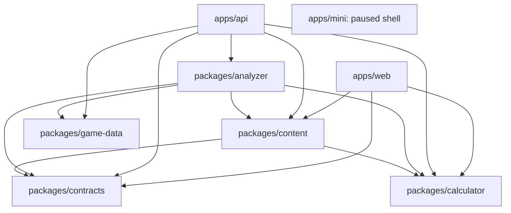
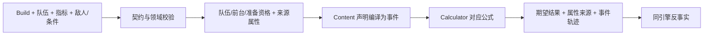

# GSCombat 当前架构

[English](architecture.en.md) · [开发指南](development.md) · [架构决策](adr/README.md) ·
[当前问题台账](plans/2026-10-08-architecture-review.md)

更新：2026-10-19。基于 `main` 的 `496e16c` 及本地尚未提交的 ARCH-015/013/007 修复，游戏数据 7.1。
本文描述当前代码与已经采用的约束；后续整改建议和验证边界单列于问题台账。

## 1. 产品与系统边界

GSCombat 是 TypeScript 模块化单体。网站与 API 分别部署，领域包在同一仓库维护。
用户配置一至四人队伍，选一个成员及其核心指标，得到期望结果、面板、公式轨迹和反事实提升。
伤害指标可以包含一次动作的多个事件；辅助指标包括治疗、护盾与属性加值。

当前不是完整循环 DPS 模拟。动作时间线用于声明命中段、额外事件和已核实的有限触发窗口；
不会自动模拟操作、资源恢复、完整元素量消耗、整队可达时序或敌人行为。
内部兼容字段 `rotation`、`dpr`、`dps` 不应被解释成产品已经提供轮转分析。

小程序目前只有暂停计算的 Taro 壳。恢复开发时复用正式分析服务；用户已确定配置使用小程序本地保存，
不依赖邀请码，不在客户端复制伤害公式。

## 2. 工作区与依赖方向

下图箭头表示“导入/依赖”，省略外部框架：



Web 到 API 是 HTTP 调用，未导入 Analyzer 或 Game-data。Mini 暂无领域包依赖。
Calculator 不依赖实体、数据库或 HTTP；Contracts 只依赖 TypeBox；Game-data 不依赖 Content/Analyzer。
这三个底层包与 Content 都不能反向依赖应用层。

| 工作区 | 实际职责 | 不应归入的内容 |
|---|---|---|
| `packages/calculator` | 普通伤害、反应、双暴、特殊反应与事件期望的纯数值公式 | 角色名、武器 ID、数据库、默认 Buff 策略 |
| `packages/contracts` | TypeBox 领域/HTTP Schema、Build 校验和协议类型 | 实体技能逻辑、数据库读写、网页状态 |
| `packages/game-data` | 自己维护的只读 SQLite、参数查询、固定来源与版本导入 | 技能施放策略、套装触发资格、用户配置 |
| `packages/content` | 角色、装备、指标、效果、能力、队伍规则及证据声明 | HTTP、用户存储、运行时网络请求 |
| `packages/analyzer` | 场景校验、面板与效果解析、指标求值、来源轨迹、反事实 | 网页状态、会话鉴权、服务调度与持久化 |
| `apps/api` | 资源组合、序列化、展示柜、可选同步、比较任务调度 | 重写角色公式或默认规则 |
| `apps/web` | 配置和计算交互、报告展示、请求失效与本地缓存 | 自己计算最终伤害或候选排名公式 |
| `apps/mini` | 暂停中的 Taro 应用壳 | 早期示意计算链路 |

## 3. 目录组织

```text
apps/api/src/
  app.ts                     Fastify 组合根与资源生命周期
  routes/                    资源入口、Schema 与协议适配
  serializers/               领域结果到公开响应
  services/                  展示柜、工作区、比较缓存/调度
apps/web/
  app/                       Next 路由组合、样式
  features/                  配置库、编辑、队伍、会话、计算、报告
  components/ui/             无业务所有权的视觉组件
  lib/                       API、格式化、图标元数据、本地存储
packages/analyzer/src/
  core/                      裸属性、Build/套装视图、前台身份、准备复用
  scenario/                  场景入口、队伍状态、能力、生命周期、准备解释
  effects/                   选择、来源、数值、依赖、武器状态、附魔
  evaluators/                语义动作、倍率、来源面板、事件与公式适配
  metrics/                   damage/healing/stat-buff/scalar 的指标求值
  analysis/                  词条、养成、武器与套装反事实
  audit/                     声明与参数完整性检查
packages/content/src/
  characters/<slug>/         definition、combat、必要证据与局部共享声明
  weapons/<slug>/            effects、coverage、必要辅助效果与能力
  artifacts/<slug>/          effects、coverage、必要辅助效果与能力
  rules/                     共鸣、月兆、魔导、夜魂等队伍规则
  combat/                    作者类型、生命周期/能力声明与校验
  registry/                  构建期静态聚合生成产物
packages/game-data/
  src/                       Repository、快照结构、来源/本地化适配
  snapshots/<version>/       只读 SQLite、manifest、必要 provenance
  sources/                   固定来源及映射资产
  tools/                     离线更新、导入和评估工具
docs/                        架构、ADR、开发/部署说明、审查和历史计划
openspec/                    行为基线与单次变更设计/任务
```

API/Web/Analyzer 的测试位于各包根 `test/`。其他库目前仍有 `src/*.test.ts`，构建排除测试。
“放在根 test 目录”不能误写成全仓已经统一。
生成注册表可以较大；手写跨职责文件的大小和耦合须另行审查。

## 4. 正式求值链路



伤害由 `evaluateScenario` / `evaluatePreparedScenario` 进入，经过队伍状态、选择规范化、效果和
声明事件求值。`evaluateScenarioAnalysis` 将其与反事实报告组合。
`evaluateCombatMetric` 的 damage 分支回到场景入口，其他分支采用独立的治疗、属性加值、标量公式。
所有分支从同一个 Content 注册表读取指标；辅助公式不强行穿过防御、抗性等伤害专属乘区。

普通伤害、直伤月/星反应、剧变反应以及多人贡献反应是不同公式类别，均由维护中的求值器分派。
它们不是彼此替代的产品入口，也不能把普通增伤区与防御区默认套进所有特殊反应。
逐段来源、技能身份、命座门槛、额外伤害与同段加值必须由 Content 声明。

`formulaAuthority` 与事件结果决定有效公式轨迹；旧单段兼容结果不能反过来覆盖特殊反应合计。
前端只渲染返回的值、阶段和来源，不能独立推导另一套最终伤害。

## 5. 效果、前后台与属性快照

三个身份必须分别保留：动作拥有者、效果来源、实际受益者。实际前台每个场景只有一人；
后台指标未指定前台时保持未知，不把每个参与者轮流当成前台。
`FieldContext` 还允许已审阅的取面板站位，它不是自动模拟的历史 Buff 快照。

Content 的 `CombatEffectLifecycle` 描述常驻、触发资格、准备方式、退场保留/清除、命中时限制和受益对象。
能力描述“能否提供合格触发或对象”，不能直接当成“已发生该事件”或“无条件满层”。
默认充分准备与必要手选采用逐项确认口径；角色和队伍的规则声明留在实体或 `rules/`。
旧 `requiresSourceOnField` / `requiresRecipientOnField` 标志仍作为兼容约束，与 lifecycle 一起校验。

来源生命、攻击、精通分享前/后、防御按显式阶段读取。跨角色加值使用来源属性而非当前主角色属性。
精通分享不能循环放大；受益对象切换不能改变实际前台。
当前上下文和转换步骤仍在多个适配点组装，这是台账 ARCH-012 的维护风险。

## 6. 反事实与性能复用

武器、套装、词条和养成对比调用相同正式求值器。候选改变后的所有合法派生属性重新计算，
不能沿用原武器的最终充能、生命转攻击或队友增益；基准和保存的 Build 保持不变。

`AnalysisPreparation` 按当前 Repository、不可变 Build 对象身份和元素缓存裸属性，生命周期属于一次分析或
有界比较会话。它不把任意最终 Buff 面板缓存为可跨场景复用的结果；调用方不可原地修改缓存中的 Build。
`EquipmentComparisonSession` 持有可信基准、准备与事件双暴样本，API 持有短期候选结果。

套装候选覆盖有效件数，使用内部 Symbol 元数据；所有有效件数读取必须经过统一 accessor。
这份视图仅在进程内求值，JSON 导出不保留，不可拿它替代真实五件装备存档。
2＋2 只使用 Content 的同类代表组合；四星方案降主词条至四星满级，保留副词条并枚举部位取最大。
四件套候选新增暴击溢出按 1:2 理论调配暴伤，限装备者与匹配事件；基准已有溢出、武器与词条分析不套用。

API 比较采用单线程协作式批次：最多 16 个不同任务、每批最多四个 yield/约 20ms、总预算 60s。
短期结果缓存最多 32 个场景、TTL 120s，估算结果预算 32MiB。
缓存键包含完整基准场景、引擎身份和 game-data manifest；候选选择与精炼另作结果/任务身份。
请求仍提交完整场景，`computationId` 用于一致性校验，不能只凭 ID 取他人的配置。

这些预算不是进程硬内存或最长阻塞保证：基准创建在队列外，单候选同步执行，活跃任务可继续持有已淘汰会话。
实际限制与改进建议见 ARCH-014。

## 7. HTTP 与 Web 请求生命周期

| 入口 | 当前职责 |
|---|---|
| `POST /v1/analysis/core` | 核心报告、面板、轨迹、词条/养成收益、计算身份 |
| `POST /v1/analysis/weapons` | 独立加载完整武器比较 |
| `POST /v1/analysis/weapon-comparison` | 单武器精炼/条件更新 |
| `POST /v1/analysis/artifact-loadouts` | 套装完整结果池、排名及指定套装 |
| `POST /v1/analysis/artifact-loadouts/candidate` | 单候选条件更新并重排结果池 |
| `POST /v1/analysis` | 兼容完整伤害分析 |
| `POST /v1/support-metrics/evaluate` | 非伤害指标 |
| `GET /v1/catalog`、`POST /v1/action-effect-options` | 目录与当前场景的可选效果 |
| `/v1/session*`、`/v1/workspace` | 可选邀请码会话与工作区同步 |
| `POST /v1/showcase/import` | Enka 展示柜转为规范 Build |

Fastify 的 `buildApp` 是组合根，持有只读游戏库、可写工作区、展示柜适配器，并在关闭时释放资源。
`routes` 绑定 Contracts，`serializers` 投影结果，`services` 管理外部访问和短期运行状态。
Analyzer 的 `AnalysisInputError` 仅含领域 code，不携带 HTTP。API 的 `services/http-errors.ts` 统一补齐错误
Schema、映射和处理：输入 400，数据/计算版本冲突 409，容量 429，预算/关闭 503，连接可写时取消 499。
未知故障仍为 500，不能因任意 Error 携带 statusCode 就视为用户错误；已发布的会话/工作区业务响应不变。

500 仅公开通用提示和服务端 UUID（`X-Request-Id`）。`services/diagnostics.ts` 按白名单输出有限源码位置及
请求/计算/候选标识，不记录原始异常、完整任务键或用户数据。显式套装选项先校验，内部候选失败保留部分结果，
并分别关联合并任务的各请求；失败不进入排名或成功缓存。Enka 外部故障区分 404/503/504/502，本地配置及
归一化程序错误仍为 500。长期边界见 [ADR-0025](adr/0025-separate-domain-input-errors-from-http-failures.md)。

Next 路由以构建时 Catalog 与内置场景装配 features。`next.config.ts` 将 `/api/backend/*` 转发至 API，
代理超时 120s；不存在单独的 Next 业务后端或第二份用户数据库。
核心结果与两类装备列表分区加载，使用冻结场景、请求身份和 AbortController 丢弃旧响应。
修改某把武器的精炼只重算该武器；套装单项条件利用已有结果池重新排名。
辅助指标不加载伤害专属装备榜单。

Catalog 是展示目录，由 Content 的实体声明/发布清单产生；不是数据库或第二套计算逻辑。
`@gscombat/content/catalog` 的 `createCatalogResponse` 统一整理 API/Web 响应，两个原入口仅薄适配。
该模块在服务端/构建阶段读取 Content，不是浏览器运行时入口；Next 继续传递可序列化 props。
共享参数契约保留 `minimumSourceConstellationByValue` 等已声明门槛，未声明时省略；权威校验仍在 Analyzer。
工厂返回独立嵌套对象。Content 声明、真实 HTTP 与 Web 目录共同验证，不能只比较序列化前的对象。
客户端静态依赖守卫和构建产物检查防止完整战斗声明流入浏览器；没有新增快照、网络请求或目录缓存。
旧根导出保持兼容，长期取舍见 [ADR-0026](adr/0026-share-server-side-catalog-projection.md)。

## 8. 两种 SQLite 与外部数据

| 数据 | 所有权与访问 | 更新方式 |
|---|---|---|
| `packages/game-data/snapshots/<version>/game-data.sqlite` | 随版本发布，只读 Repository | 自己维护 SQLite，版本增量导入与固定来源记录 |
| `runtime/workspace/workspaces.sqlite` | 部署侧可写，按邀请码隔离 | 用户工作区文档与 revision，不进入 Git |
| 浏览器配置 | 用户本地；持久存储不可用时退至同页内存 | 导入/导出，选择邀请码后可同步 |
| Enka 展示柜 | 外部网络获取，规范化为普通 Build | 固定元数据映射与 UID TTL 缓存 |

7.1 是既有 7.0 行加上两名角色和六把武器，旧魔女相关参数继续保留。
genshin-db 和原始参数补源用于离线导入，来源与哈希记入 provenance；运行时不向这些数据库查询。
SQLite 才是运行时的事实来源，Content 将参数绑定到动作与乘区。
展示柜 API 与静态游戏数据库是两个独立职责。

当前 manifest `dataSha256` 表示来源身份；7.1 具体为紧凑序列化 provenance 的哈希，不能称为 SQLite 文件摘要。
运行时 Repository 设只读/query_only，但不自动验证所有发布资产一致；见 ARCH-016。

工作区采用 schemaVersion 1 聚合文档和乐观 revision 条件写入；保存条件不匹配拒绝覆盖。
浏览器配置库支持多个同角色配置，队伍引用 Build ID。前台/准备状态属于计算场景，不写为角色固有存档状态。
云端同步由 `useWorkspaceSession` 串行管理；无邀请码的分析请求不意味着创建服务端工作区。

## 9. 扩展、生成与治理

新增角色首先维护其实体目录的指标、动作、能力、天赋命座和审阅参数；新增装备维护效果与 coverage。
已有类型能表达的普通声明不需要新增通用机制。新乘区、反应、共享上下文或协议变化使用 OpenSpec，
长期取舍保存在 ADR。

Content 注册表由构建期工具静态生成，`build/test/typecheck` 检查新鲜度；运行时不 glob 扫描实体。
展示柜与图标有各自固定来源的生成工具，仍须在数据发布时明确一起验证。
公开调用使用包 exports，Analyzer 内部路径不形成兼容承诺。
ARCH-007 已收口为共享 Catalog 子入口和投影；旧 Content 根导出为兼容保留，不表示全量移除其宽导出面。

AGENTS 是执行入口，OpenSpec config 是跨变更约束，主 specs 是行为基线，changes 记录单次设计/实施，
ADR 记录理由。历史计划与测试总数不应代替当前状态。
部分已实施 delta 尚未同步到主规格，旧全库映射计划也尚未收口；参考 ARCH-019。

## 10. 验证、部署与已知风险

已有局部架构守卫覆盖 API/Web/Analyzer 的依赖、目录与部分体积约束；Content 注册表有生成检查。
全仓包依赖方向、完整路由集、所有生成资产和 CI 仍未形成一个自动化总门禁。
类型检查与绿色测试不能证明所有角色参数/乘区已正确，需用真实场景验证数值来源和反事实一致性。

当前生产为 Caddy + Web + API Docker Compose；只读游戏库随镜像发布，可写用户库与备案/联系方式配置位于部署侧。
发布按同一 Git SHA 重建，用户库须 SQLite 在线备份并校验，不能覆盖 runtime。
生产 Compose 要求密钥并挂载工作区；`buildApp` 也在打开数据库前要求显式有效密钥与文件型工作区，
拒绝公开默认/示例值和内存/URI 路径。管理邀请码始终采用严格配置，开发/测试 API 才保留便利默认值。
配置错误不会创建替代库；后续初始化或监听失败释放已取得资源并保持原始失败原因。
此为 ARCH-015 的本地已验证修复，尚未部署；不自动轮换密钥、不迁移用户数据。

2026-10-08 复审验证 API 176 项、Analyzer 608 项与 Web 44 项。
Web 在本机 Node 26 需 `NODE_OPTIONS=--no-experimental-webstorage`；生产镜像仍为 Node 22。
2026-10-19 的 ARCH-015 验收通过 API 185 项测试、类型检查及构建；未重跑无变更的全角色数值测试。
ARCH-013 验收另通过 Analyzer 609 项、API 192 项、Web 44 项，以及根类型检查和构建；公式及既有数值断言不变。
错误矩阵覆盖输入/内部边界、上游、部分失败、请求关联和隐私；不等于重新认证全部角色机制。
没有提交、推送或部署。ARCH-013 证据见[错误边界修复记录](../openspec/changes/normalize-api-domain-errors/implementation-progress.md)，ARCH-015 见
[修复记录](../openspec/changes/harden-production-api-startup/implementation-progress.md)。
详细风险、复现、建议顺序及未完成项以[当前台账](plans/2026-10-08-architecture-review.md)为准。

ARCH-007 验收通过根类型检查、测试和构建；API/Web 目录均为 150,041 字节，真实接口与页面完整数据一致。
相对实施前基线，Web 内容不变，目录/覆盖接口各仅补回同一个按值命座限制；详见
[Catalog 实施记录](../openspec/changes/unify-catalog-projection/implementation-progress.md)。未提交或部署。
